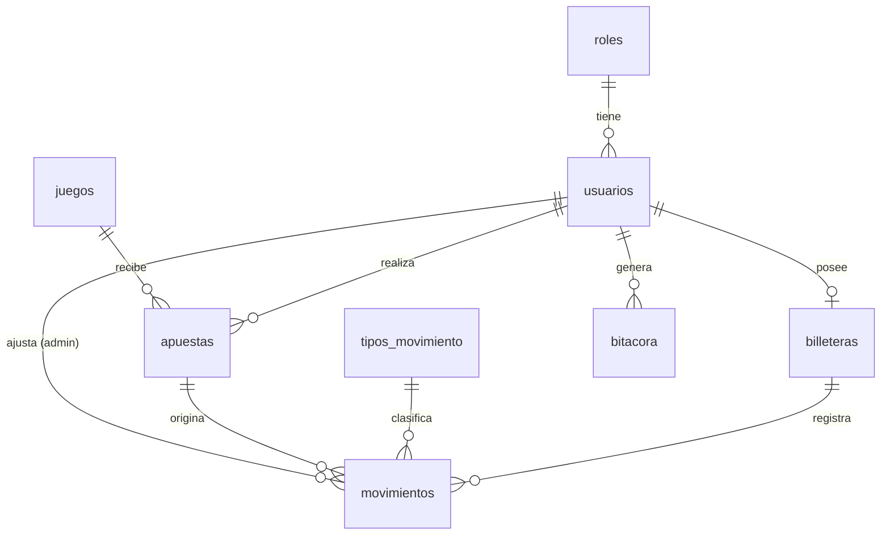

# Base de datos

MySQL 8, 8 tablas en tercera forma normal. Script: [`db/schema.sql`](schema.sql) ·
datos de prueba: [`db/seed.sql`](seed.sql) (generado con `npm run seed:generate` en `backend/`).

## Diccionario de datos

| Tabla | Campo | Tipo | Restricciones | Descripción |
|---|---|---|---|---|
| **roles** | id | TINYINT | PK | 1 = admin, 2 = jugador |
| | nombre | VARCHAR(20) | UNIQUE | Nombre del rol |
| **usuarios** | id | INT | PK, AI | |
| | rol_id | TINYINT | FK → roles | |
| | nombre | VARCHAR(100) | NOT NULL, índice | Nombre completo |
| | correo | VARCHAR(120) | UNIQUE | Usuario para iniciar sesión |
| | password_hash | CHAR(60) | NOT NULL | Hash bcrypt |
| | fecha_nacimiento | DATE | NOT NULL | Para validar RN-01 |
| | activo | BOOLEAN | default TRUE | Baja lógica |
| | creado_en / actualizado_en | DATETIME | | |
| **billeteras** | id | INT | PK | |
| | usuario_id | INT | FK → usuarios, UNIQUE | Una billetera por jugador |
| | saldo | DECIMAL(12,2) | CHECK ≥ 0 | RN-03 |
| **juegos** | id | INT | PK | |
| | slug | VARCHAR(30) | UNIQUE | Identificador para URLs |
| | tipo | ENUM | blackjack, poker, ruleta, billar | Lógica que usa el servidor |
| | nombre | VARCHAR(60) | UNIQUE | |
| | descripcion | VARCHAR(255) | | |
| | apuesta_min / apuesta_max | DECIMAL(10,2) | CHECK min > 0 y max ≥ min | RN-02 |
| | activo | BOOLEAN | | RN-05 |
| **tipos_movimiento** | id, clave, nombre | | clave UNIQUE | recarga, apuesta, premio, ajuste, bono |
| **apuestas** | id | INT | PK | |
| | usuario_id, juego_id | INT | FK | |
| | monto | DECIMAL(10,2) | CHECK > 0 | |
| | multiplicador | DECIMAL(6,2) | NULL mientras está en curso | RN-06 |
| | pago | DECIMAL(12,2) | CHECK ≥ 0 | monto × multiplicador |
| | estado | ENUM | en_curso, ganada, perdida, empate | |
| | estado_juego | JSON | | Cartas, rueda o bolas (incluye el mazo oculto) |
| | creado_en / resuelto_en | DATETIME | índices | |
| **movimientos** | id | INT | PK | |
| | billetera_id | INT | FK | |
| | tipo_id | TINYINT | FK | |
| | monto | DECIMAL(12,2) | CHECK ≠ 0 | + abono, − cargo |
| | saldo_resultante | DECIMAL(12,2) | CHECK ≥ 0 | Saldo después del movimiento |
| | apuesta_id | INT | FK, NULL | Apuesta que lo originó |
| | creado_por | INT | FK → usuarios, NULL | Admin que hizo un ajuste (RN-07) |
| **bitacora** | id | BIGINT | PK | |
| | usuario_id | INT | FK, NULL | Quién hizo la acción |
| | accion | VARCHAR(40) | índice | login, registro, recarga, apuesta, ajuste_saldo, … |
| | entidad / entidad_id | | | Sobre qué registro |
| | detalle | JSON | | Datos de la operación |
| | ip | VARCHAR(45) | | |
